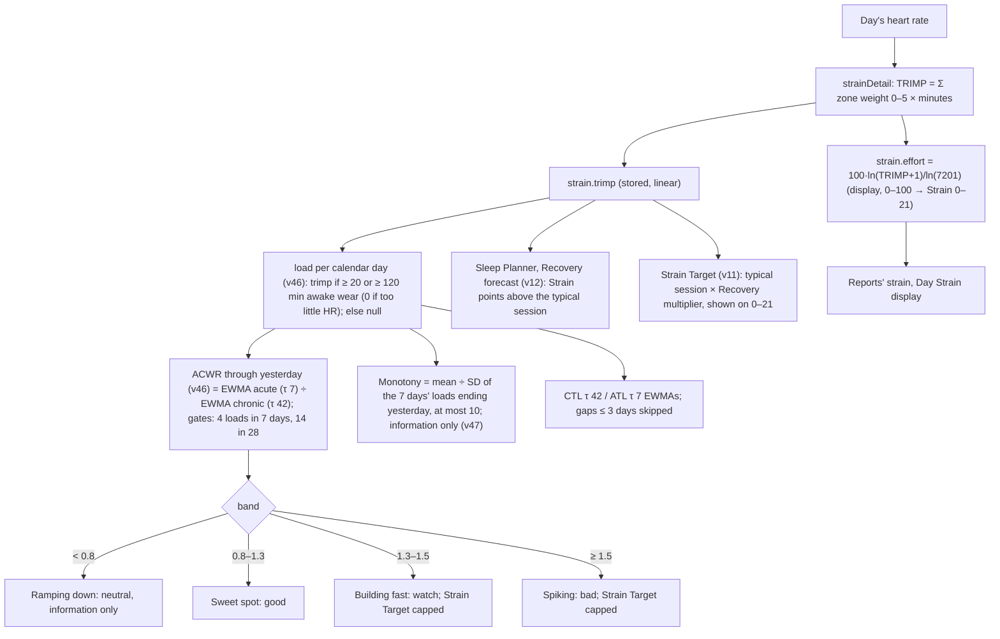

# Training load: ratio, monotony, fitness / fatigue / form

Code:
- `src/core/scoring/readiness.ts` (ACWR, monotony)
- `src/core/scoring/trainingLoad.ts` (CTL / ATL / TSB)
- `src/core/scoring/strain.ts` (`strainDetail`, the daily TRIMP)
- `src/server/pipeline/scores.ts` (`scoreTrainingLoad`)

Tests: `readiness.test.ts`, `readiness.acwr.sim.test.ts`, `trainingLoad.test.ts`, `strain.test.ts`, and `pipeline.test.ts`
("scale contracts", "the training-load ratio on the seed").

Training load answers three questions about your heart-rate load:
- **Training balance (ACWR):** is this week's load above or below what you are used to?
- **Monotony:** is every day the same? Information only since version 47: it never changes the readiness level.
- **Fitness, fatigue and form (CTL / ATL / TSB):** long-term load, short-term load, and the gap between them.

Since `SCORING_VERSION` 10, all three run on each day's **linear load (TRIMP)**, not on the 0–100 Effort behind the
0–21 Strain. § Why explains the change.

## Flow

## Which load each feature uses

| Feature | Input | Why |
|---|---|---|
| ACWR, monotony | TRIMP | They are ratios of load. On a log scale every change shrinks (§ Why). |
| CTL / ATL / TSB | TRIMP | Banister's model is defined on linear load |
| Strain Target | TRIMP (since v11), displayed on 0–21 | Its typical session and multipliers are in load; see [strain-target](strain-target.md) |
| Sleep Planner extra need | TRIMP vs the typical session (since v12), in Strain points | 3 min per point above your session, up to 30; see [sleep-planner](sleep-planner.md) |
| Recovery forecast | TRIMP vs the typical session (since v12), in Strain points | −3 per point above your session, never positive; see [recovery-forecast](recovery-forecast.md) |
| Reports' "avg strain", Day Strain | Effort → 0–21 | Display |

## Formula

**Daily load.**
- `strainDetail()` returns `{ effort, trimp }`. `trimp` is the TRIMP whose log map is Effort: Edwards zone-minutes,
  or Banister above its resting floor.
- Stage 1 stores it as `daily_scores.strain.trimp`. It is null exactly when Effort is null.
- Stage 2 feeds one row per calendar day (`seenLoad`, `core/scoring/load.ts`, *since version 46*), stored as
  `training_load.load`:
  - `null` when the band was off (`hrCount` 0);
  - the TRIMP (0 if too little heart rate for Effort) when it is at least **20** (`minSeenLoad`, a workout counts on
    any wear) or the band was on at least **120 minutes while awake** (`minAwakeWornMin`; heart-rate minutes outside
    sleep sessions, `awakeWornMin`);
  - otherwise `null`: the day wasn't seen.

  Until version 45 any heart-rate sample made a measured day, so a day worn only in bed was a rest day of about 0
  although its activity was never seen (§ Why version 46).
- **Today's row is the load so far.** The pipeline scores today while it is still going, so this morning's row
  holds only the hours since midnight, usually close to 0. *Since version 46* the ratio, monotony and the
  readiness load signal therefore run **through yesterday** (`loadThrough: "yesterday"`): day D's row describes the
  load up to D−1 and doesn't change during the day. HRV, resting HR and respiration still read last night. CTL/ATL
  are still computed through D for each day; Fitness's chart shows complete days only (it ends yesterday while today
  is going).

**ACWR** (*since version 45*, exponentially weighted; Williams 2017), evaluated through the day before `today`
(*since version 46*; the pure function's default is through `today`):

    acute   ← acute   + (1 − e^(−1/7))  × (load − acute)       over each day with a load, oldest first
    chronic ← chronic + (1 − e^(−1/42)) × (load − chronic)
    ACWR    = acute / chronic           (needs ≥ 4 loads in the 7 calendar days ending yesterday, ≥ 14 in the 28,
                                         and chronic ≥ 30)

- Both start from the mean of the first 7 loaded days (`acwrPrimeDays`, as Fitness).
- A day without a load takes no step. Unlike Fitness's run, a long gap never restarts the history: the ratio picks up
  where it left off.
- The time constants are Fitness's ATL and CTL (`acwrConfig`, from `trainingLoad.standardConfig`). On a history
  without gaps of more than 3 days the ratio is exactly ATL ÷ CTL.
- The 7- and 28-day windows remain only as coverage gates and for monotony.
- Until version 44 acute and chronic were the plain means over the 7 and 28 calendar days (coupled, Gabbett's form).
  § Why version 45 explains the change.

**A light load** (*since version 27*, `acwrChronicFloor = 30` TRIMP a day): when chronic is under 30,
- if acute ÷ 30 ≥ 1.3, ACWR = acute ÷ 30. That is a jump that is large in absolute terms, banded as usual (building
  fast or spiking), and the signal's evidence carries `floor: 30`;
- otherwise ACWR is **null** and `lightLoad` is true. There is no band, no readiness signal, and no Strain Target cap.
  Fitness and Reports show "Light load: too little training load to compare weeks".

- Rows after `today` are ignored.
- Before version 10 the windows were "the last 7 / 28 rows with a value", so unworn days pulled in older days.
- **Step response.** After a long steady stretch, k times the load every day reads
  (1 + (k − 1)(1 − e^(−t/7))) ÷ (1 + (k − 1)(1 − e^(−t/42))) on day t. It peaks around day 10–14: 2× peaks at
  about **1.46** (building fast) and spiking needs about 2.3× sustained. Version 44's plain means read 4k / (k + 3)
  after a week (2× gave 1.60). Real weeks are lumpier than this, and their session days lift acute above the smooth
  curve, so a doubling of a 3-sessions-a-week trainer still reads spiking within 10 days for most people (§ Why
  version 45).

**Bands** (`acwrBand`, unchanged edges):

| ACWR | Band | Readiness flag | Strain Target | Words (Fitness / Reports) |
|---|---|---|---|---|
| < 0.80 | `LOAD_RAMPING_DOWN` | **neutral** (was watch) | **no change** (was +10 %) | Detraining / Undertrained |
| 0.80–1.29 | `LOAD_SWEET_SPOT` | good | no change | Optimal / Balanced |
| 1.30–1.49 | `LOAD_BUILDING_FAST` | watch | upper bound capped at the base (above 1.3) | Pushing / Overreaching |
| ≥ 1.50 | `LOAD_SPIKING` | bad | capped | High risk / Overreaching |

**Monotony** (Foster):

    monotony = mean / sample SD of the loads in the 7 calendar days ending yesterday     (same gates as ACWR)

- **Information only (version 47).** It is stored with the row but is not a readiness signal, so it never changes
  the level. Versions 10–46 added a "watch" at ≥ 2.0 (Foster's "high"), which kept every regular daily trainer from
  "primed" (§ Why version 47).
- **At most `monotonyMax` (10).** An SD at or below 1e-9 × max(1, mean) counts as zero, and identical days read
  10: the most monotonous week, not none. Versions 10–46 gave no monotony there (null), to avoid the ~3 × 10¹⁵ that
  an SD of ~1e-14 from rounding produced.
- A week whose loads are all 0 has no monotony.

**Fitness / fatigue / form** (`trainingLoad.evaluate`):

    CTL ← CTL + (1 − e^(−1/42)) × (load − CTL)
    ATL ← ATL + (1 − e^(−1/7))  × (load − ATL)
    TSB = CTL − ATL

- Both are seeded with the mean of the first 7 loads of the run.
- **The run** walks back from today day by day. A day with no load (missing row or null) is a **gap**: no point and no
  EWMA step. The run ends only after more than `maxGapDays` = 3 gap days in a row.
- `contiguousDays` is the number of days with a load in the run. The state is `building` from 14 days and
  `established` from 42.
- Before version 10, any single gap ended the run. That threw away all history and blanked the chart for 14 days.
- Values are now in TRIMP units. On the seed, CTL runs from about 50 to 110.

## Why

### The problem (verified on version 9)

- **Effort is a log map of TRIMP.** It is `100·ln(TRIMP+1)/ln(7201)`, chosen so the 0–21 Strain feels like WHOOP's.
  It works for display, but a ratio of logs is not a ratio of loads.
- **Example:** with a usual week of 4 workouts at 118 TRIMP and 3 rest days at 9 (seed-typical: Effort 53.8 / 25.9):

| This week | ACWR on Effort (v9) | ACWR on TRIMP (v10) | Monotony on Effort (v9) | Monotony on TRIMP (v10) |
|---|---|---|---|---|
| Usual | 1.00 | 1.00 | **2.81** (watch) | 1.22 |
| Workouts 1.5× | 1.05 | 1.32 | 2.56 | 1.17 |
| Workouts 2× | 1.08 | 1.57 | 2.43 | 1.14 |
| Workouts 3× | **1.12** (sweet spot) | **1.96** (spiking) | 2.28 | 1.12 |
| Everything 2× | 1.13 | **1.60** | 3.25 | 1.22 |
| No rest days, usual sessions | 1.20 | 1.42 (building fast) | — | — |

- Rest days and workout days look alike on Effort (26 vs 54), so the week's SD is small and monotony is high every
  week.
- A real spike barely moves the ratio.

### On the 180-day demo database

The seed's 3-week training block runs 2026-05-25 to 06-14.

| | v9 (Effort) | v10 (TRIMP) |
|---|---|---|
| ACWR days: sweet / ramping down / building fast / spiking | 141 / 20 / 6 / **0** | 91 / 46 / 14 / **16** |
| Peak ACWR (in the training block) | 1.35 | 1.98 |
| Days with monotony ≥ 2 (a "watch" until version 47) | **147 / 167** | 17 / 167 (mostly the block's no-rest weeks) |
| Days fitness / fatigue / form unavailable | 27 (the first 13, plus 14 after one band-off day on 2026-09-09) | 13 (the first 13 only) |
| Strain Target capped / lifted | ratio above 1.3 on 6 days / below 0.8 on 20 | capped 30 / lifted 0 |

Recovery, Effort, Sleep, Energy Bank, Stress and the Health Monitor are unchanged (the golden and parity tests).

### Decisions

1. **Coupled 7/28, not "last 7 ÷ the 3 weeks before".** *Superseded in version 45 by EWMA acute and chronic (§ Why
   version 45); the edges stayed.*
   - With all 28 days observed, the uncoupled ratio U and the coupled C are tied exactly: U = 3C / (4 − C).
   - So uncoupled with edges 0.75 / 1.44 / 1.80 puts every day in the same band as coupled with 0.8 / 1.3 / 1.5. They
     differ only in the number shown (2× load: 1.60 vs 2.00) and when data is missing.
   - Coupled keeps the published edges, the Fitness gauge (0.5–2.0) and the copy.
   - The literature's objection to coupling (Lolli 2019: spurious correlation with injury) is about injury studies,
     not about banding a day.
2. **Ramping down is information only.**
   - On linear load a ratio under 0.8 is every deload, illness or holiday week: 46 of 153 seed days.
   - As a "watch" it would nag on 30 % of days.
   - Strain Target's +10 % lift would push harder right after illness.
   - The band and its words stay. The high side is unchanged.
3. **Fitness carried across short gaps.** A missing day is unknown, not a rest day: it neither adds load nor decays
   it. Three days covers a weekend without the band; longer gaps restart, since the averages would be stale.

## Why version 27: a light load has no ratio

**The problem.** ACWR's only guard was chronic > 0. For someone whose days are nearly all rest, acute ÷ chronic is
the ratio of two near-zero means, so it is noise:
- after weeks of rest-level days (about 3 TRIMP), one 40-TRIMP walk read **spiking** for 30 of 30 simulated people,
  and readiness turned "strained";
- steady sedentary days read building fast or spiking 13 % of the time.

**How it was tested.** 30 simulated people per case through the real `evaluate`; the prototype's "version 26" mode
matched it on every day. Daily TRIMP is log-normal: rest days around 4, walks and sessions as named.

**A floor in the denominator** (acute ÷ max(chronic, F)) stops the false spikes, but moves every low-load person into
"ramping down", which the app shows as "Undertrained: your load dropped below your usual". At F = 30, that was 98.6 %
of a 2 × 50 light trainer's days and 84 % of an older daily walker's. Rejected.

**No band at all under F** misses real spikes: a sedentary person who starts running 5 days a week read nothing 40 %
of the time at F = 30. Rejected.

**The chosen hybrid.** No ratio under F, unless acute ÷ F is itself a jump. Shares of days:

| Case | Version 26: spiking / building | F = 20 | **F = 30** | F = 40 |
|---|---|---|---|---|
| Weeks of rest, one 40-TRIMP walk | 100 / 0 | light | **light** | light |
| Steady sedentary (an occasional 15-TRIMP walk) | 4.2 / 8.5 (and 23 % ramping down) | light | **light** | light |
| Older adult's daily walk (about 25) | 2.2 / 9.0 | 0.8 / 5.2, 67 % light | **light** | light |
| Light trainer, 2 × 50 a week | 0 / 1.7 | 96 % light | **light** | light |
| Sedentary starts walking 40 a day | 98.6 / 1.0 | 67.1 / 4.8 | **8.1 / 31.0** | 0 / 0.2 |
| Sedentary starts running 5 × 120 a week | 100 spiking | 100 | **100** | 100 |
| Light 2 × 50 → 5 × 100; regular 3 × 100 → 6 × 150 | 89 / 84 spiking | unchanged | **unchanged** | about unchanged |
| Moderate 3 × 80 (chronic about 36) | 95 % sweet spot | unchanged | **unchanged** | 90 % light |
| Regular 4 × 118 | 98 % sweet spot | unchanged | **unchanged** | unchanged |

**Why F = 30:**
- 20 still calls a new daily walk "spiking" two-thirds of the time.
- 40 hides a moderate 3-sessions-a-week trainer.
- 30 TRIMP a day is about 3.5 h a week of easy walking, under the guideline 150 min of moderate activity. Below it
  a load *ratio* says little; the absolute load matters more.

The sedentary walker who starts 40 a day is a real 10× jump, so "building fast" (and on the heaviest weeks
"spiking") is fair there.

**On the seed** the chronic load is 44–155 a day, so nothing changes. Only the new `lightLoad` field (false) is
added to `training_load` and the reports.

## Why version 45: session timing no longer drives the bands

**The problem (audit T3).** The 7-day mean has a hard edge. A session counts fully for 7 days and then drops out
at once on day 8. So the same weekly load on different days swings the ratio:
- 3 sessions a week on random days, at a steady average, read building fast or spiking on 11 % of days, and
  Strain Target was capped on 11 %;
- 1–5 sessions a week read spiking ("strained") on 8 % of days and capped on 18 %;
- the ratio's p5–p95 ran from 0.22 to 1.83 at the same average load.

The warnings stopped meaning anything for anyone who doesn't train on fixed days.

**How it was tested.** `readiness.acwr.sim.test.ts`: 30 simulated people × 154 days per case through the real
`evaluate`, with version 44's rule kept in the test as a reference on the same people. "Capped" is Strain Target's
rule: yesterday's ratio over `acwrCapAbove` (1.3), which comes ahead of every other hold.

**The sweep.** Acute τ 3.5 / 5 / 7 × chronic τ 21 / 28 / 42 × a hold of 1 / 2 / 3 days (the stored ratio being the one
nearest the sweet spot among the last *n* days). Shares of days, and the share of people caught within the window:

| Setting | Random 3/wk: building + spiking / capped | 1–5/wk: spiking / capped | +50 % caught in 7 d | 2× spiking in 10 d | After illness: spiking |
|---|---|---|---|---|---|
| Version 44 (7/28 means) | 11.2 / 11.2 | 8.1 / 18.3 | 83 % | 87 % | 11.9 % |
| τ 3.5 / 28 | 13.5 / 13.4 | 7.9 / 19.7 | 93 % | 100 % | 11.1 % |
| τ 5 / 28 | 5.5 / 5.4 | 2.8 / 13.6 | 93 % | 97 % | 2.6 % |
| τ 7 / 28 | 1.0 / 1.0 | 0.2 / 6.6 | 53 % | 50 % | 0.2 % |
| **τ 7 / 42 (chosen)** | **2.3 / 2.3** | **2.0 / 11.6** | **87 %** | **83 %** | **0.4 %** |
| τ 7 / 42, 2-day hold | 0.4 / 0.4 | 1.0 / 7.3 | 20 % | 33 % | 0 % |
| τ 7 / 28, 2-day hold | 0.2 / 0.2 | 0.1 / 3.9 | 10 % | 17 % | 0 % |

- **τ 7 / 42 is the best trade-off.** It removes nearly all scheduling noise and still catches a real +50 % step at
  least as often as version 44. Its constants are Fitness's ATL and CTL, so the ratio agrees with the chart.
- **The hold was dropped.** A real ramp on irregular days bounces around 1.3, so holding for 2 days hid most real
  increases (20 % caught) while removing little noise that the EWMA hadn't already.
- **A shorter acute τ** (3.5–5) catches ramps a day or two sooner but keeps most of the noise.
- The 1–5-sessions case keeps some flags: a 5-session week after 1-session weeks is a real jump.
- 3 sessions a week on fixed days: building fast or spiking 1.7 % → 0.4 %.
- **Returning after illness** (audit T6), a steady 3 × 80 trainer:
  - 10 rest days, then training resumed: spiking on 11.9 % of the next 4 weeks; now 0.4 %;
  - 7 sick days with the band on: building fast or spiking 16 % → 0.7 %;
  - after a 21-day break with the band on: spiking 2.5 % → 0.2 %. The chronic load (about 36) decays under the light-load
    floor during the break, so most of the 4 weeks after return read "light load" instead.

**What gets less sensitive.** On smooth loads the EWMA ratio stays nearer 1 than the plain one:
- a single week at 2× the usual load reads 1.37 (building fast; version 44: 1.60, spiking);
- a week with no rest days at the usual session load (1.65× the week) reads 1.28, the sweet spot (version 44:
  1.40), and a second such week builds fast;
- a huge block fades over about 6 weeks (τ 42) instead of dropping out on day 29. After the seed's 3-week block, the
  steady weeks that follow read ramping down (informational) on 22 of July's 31 days (0.67–0.88; version 44: about
  0.5 rising to 1.0).

**On the 180-day demo database** (167 days with a ratio):

| | Version 44 | Version 45 |
|---|---|---|
| Sweet spot / ramping down / building fast / spiking | 91 / 46 / 14 / 16 | 81 / 63 / 5 / 18 |
| Strain Target capped | 30 | 23 |
| Peak ACWR (the training block) | 1.98 | 1.93 |
| Return after the illness (days 125–152) | building fast on 9 days (1.30–1.37) | 0.38–1.00, never building fast |

- The training block (from 2026-05-25) reads building fast from its second day (1.32). It spikes from 05-30 to 06-16
  (version 44: 05-26 to 06-11): the EWMA is 4 days slower to spike and remembers the block 5 days longer.
- Recovery, Sleep, Energy Bank, Stress, the Health Monitor and Healthspan are unchanged (golden test). Training
  load, Strain Target and the reports' training balance move.

**On the owner's data** (local copy, full history), heart rate exists only from 2026-10-03, so neither version has
a ratio yet: nothing changes.

## Why version 46: complete, seen days

**The problems (audit T4, T5).**
- **T5: today was scored while it was still going.** This morning's load is only the night's (about 0), and the ratio
  ran through today, so it described a hypothetical rest day and changed after the workout. On v45, the band
  differed between morning and evening on 37–49 % of training days (3 sessions a week, fixed or random days, or 1–5);
  the morning ratio was a median 0.78× the evening's. The copy already said "up to yesterday", and Strain Target
  already read the previous day's ratio.
- **T4: a day worn only in bed was a measured rest day.** Any heart-rate sample made a day "worn", so a day with the
  band off from waking to bedtime fed a load of about 0, and its workout (if any) was lost as a rest day. With 1 day
  in 5 worn only in bed, a steady 3-a-week trainer's chronic load (about 36) was pulled under the 30 floor, so the
  ratio went missing ("light load") on 13 % of days, and false building fast or spiking rose.

**T5: through yesterday.** Day D's ratio, monotony and readiness load signal use the days up to D−1. In simulation
(`readiness.acwr.sim.test.ts`, 30 people, random-day 3-a-week), the morning and evening bands now agree on every
training day (v45: about 40 % differed). The ratio is a day later to react, which the EWMA's own lag dwarfs.
- **Strain Target is unchanged.** It already used the previous day's ratio, now the row's own (`acwrPrior` is gone).
- **Reports** use the last day of the period with a ratio, now through the day before the period's end.
- **The Fitness chart** keeps CTL/ATL per day through that day, and shows complete days only.

**T4: the seen-day rule, swept.** 30 people × 154 days, 3 a week on fixed or random days and 1–5 a week, through
the real `evaluate` (through yesterday), against the same people fully seen. Wear patterns:
- all day;
- 1 day in 5 worn only in bed (10–40 minutes on after waking), with half of those days' workouts done with the band on;
- worn only in bed on most days;
- 2–6 h of daytime wear that includes the workout.

Random days, 1 day in 5 worn only in bed (shares of days):

| Rule | False building fast / spiking | False ramping down | No ratio |
|---|---|---|---|
| Version 45: any heart rate | 3.6 % | 4.3 % | 16.7 % |
| ≥ 60 awake minutes | 3.0 % | 3.4 % | 1.4 % |
| ≥ 120 awake minutes alone | 4.6 % | 4.1 % | 5.1 % |
| **≥ 120 awake minutes, or ≥ 20 TRIMP (chosen)** | **3.0 %** | **3.4 %** | **1.4 %** |
| ≥ 240 awake minutes, or ≥ 20 TRIMP | 3.0 % | 3.4 % | 1.4 % |

- **The workout clause matters.** Without it, a day worn only for the run (60–90 awake minutes) became unknown, and
  the 120-minute rule lost workouts.
- **240+ minutes blanked short wearers.** With 2–6 h of daytime wear, 240 left 7–11 % of days without a ratio, and 360+
  left 76–100 %. Up to 120, short wearers read exactly as before.
- **Fixed days and 1–5 a week**, same rule: no ratio 11.9 → 1.5 % and 26.3 → 3.5 %. False building fast or spiking
  1.2 → 1.8 % (fixed) and 3.4 → 2.7 % (1–5). False ramping down 5.4 → 4.6 % and 3.4 → 5.6 %. An unseen workout is
  lost either way; what changed is that it no longer counts as a rest day.
- **Worn only in bed on most days:** no ratio on 90–99 % of days either way (v45: mostly "light load"), now because
  the days are unknown.
- **All-day wearers are identical.**
- **The repo's test** (its own draws): no ratio 13.1 → 1.4 %, false high 2.9 → 2.1 %, false ramping down
  4.9 → 5.1 %.

**On the demo database** the band is worn all day. Only day 157 (8 worn minutes before a band-off stretch) became
unknown, so its CTL/ATL run carries one more gap day. Every ratio moved a day later: sweet spot / ramping down / building
fast / spiking 81 / 62 / 5 / 18 (v45: 81 / 63 / 5 / 18). Strain Target, the Sleep Planner and journal impact are
unchanged (golden test). A seed week worn only in bed now leaves those days unknown, and the ratio stays within 0.09
of the fully worn one (v45's rule: up to 0.51 off).

**On the owner's data** (local copy, full history): all days were worn all day, so every load is unchanged, and
there is no ratio yet in either version.

## Why version 47: monotony is information only

Readiness is "primed" only with at least two good signals and **no** "watch". Monotony (the week's mean load ÷ its
SD) raised a "watch" at 2.0, and a regular schedule is always over that: a day of training every day has a small SD
next to its mean. Measured on version 46 (80 days each, clearly good HRV and RHR on the last, the ratio in the sweet
spot):

| Schedule | Days with monotony ≥ 2 | Level on that good day (v46) | v47 |
|---|---|---|---|
| Every day, 150 TRIMP ± 20 % | 80 / 80 (about 8.8) | balanced | primed |
| 6 a week, one rest day | 80 / 80 (about 2.2) | balanced | primed |
| A daily 40-TRIMP walk | 80 / 80 (about 8.0) | balanced | primed |
| 5 or 3 a week | 0 / 80 | primed | primed |
| Identical every day | never (null) | primed | primed (monotony 10) |

- **It says nothing about today.** A regular week reads the same every week, so the flag was on for good. It ignores
  how much someone trains (a walker was flagged like an athlete), and identical days, the most monotonous week,
  were the only daily schedule not flagged.
- **Foster used it inside strain** (weekly load × monotony) to explain illness in hard, unvaried blocks. Alone it was
  never an alarm. A strain gate against the person's own history was considered; it adds a baseline and constants
  for a value nothing shows yet, so it is left for when readiness has a screen.
- **Nothing reads the level or monotony today.** No page, report, coach tool or journal uses `training_load.level` or
  `monotony` (only `acwr` and `lightLoad`), so this corrects the stored rows before any readiness UI shows them.

**Simulation** (`readiness.acwr.sim.test.ts`, 30 people × 112 days per schedule, HRV and RHR independent of load):
primed on 33.0 / 33.0 / 33.0 % of days for daily / 6-a-week / 3-a-week trainers (v46: 0 / 6.4 / 33.0 %). Strained or
run down is the same across schedules (30–31 %): monotony was only ever a watch, so it never made anyone strained.

**On the demo database** nothing moved but the version stamps (golden test). Its 17 days with monotony ≥ 2 (at most
4.5) were 11 strained, 4 run down and 2 balanced on other signals (ramping down with one good signal), and no week is
identical.

**On the owner's data** (local copy, full history): no day has passed the ratio gates yet, so there is no monotony
and nothing changes.

## Constants

| Constant | Value | Kind |
|---|---|---|
| ACWR acute / chronic τ (`acwrConfig`) | 7 / 42 days (Fitness's ATL / CTL) | Pulse v45 (Williams 2017; sweep in § Why version 45) |
| `acwrPrimeDays` | 7 loaded days | as `primeDays` |
| `minSeenLoad` / `minAwakeWornMin` (`seenLoadConfig`) | 20 TRIMP / 120 minutes | Pulse v46 (sweep in § Why version 46) |
| Load signals' last day (`loadThrough`) | yesterday | Pulse v46 |
| `acuteWindow` / `chronicWindow` | 7 / 28 calendar days (gates and monotony only since v45) | noop (calendar days: Pulse, v10) |
| `minAcute` / `minChronic` | 4 / 14 days with a load | Pulse v10 / noop |
| ACWR band edges | 0.8 / 1.3 / 1.5 | Gabbett 2016 (team-sport injury data, a rule of thumb) |
| `monotonyMax` | 10 (identical days read it) | Pulse v47 (Foster's "high" is 2; a daily trainer varying ±20 % reads about 9) |
| `monotonySdEpsilon` | 1e-9 (relative) | Pulse v10 |
| ~~`monotonyWatch`~~ | ~~2.0~~ (removed in v47: monotony raises no signal) | Foster 1998 |
| CTL / ATL τ | 42 / 7 days | TrainingPeaks / Coggan convention |
| `primeDays` / `minimumDays` / `establishedDays` | 7 / 14 / 42 | noop |
| `maxGapDays` | 3 | Pulse v10 (noop: 0) |
| Strain Target `acwrCapAbove` | 1.3 | spec (the lift below 0.8 is removed; since v11 a cap holds the top at your typical session; it reads the ratio through yesterday) |

## Worked examples (each is a test)

1. **Twice the usual load for a week.** Three usual weeks (4 × 118, 3 × 9), then every day doubled: ACWR **1.37**,
   building fast. Version 44's plain means read (2 × 71.3) / ((3 × 71.3 + 2 × 71.3) / 4) = 1.60 (spiking); on
   Effort it read 1.13, the sweet spot.
2. **A step in closed form.** 21 days at 60, then 7 at 90. Seeded at 60, each EWMA closes all but e^(−7/τ) of the
   gap: acute = 90 − 30e^(−1) = 78.96, chronic = 90 − 30e^(−1/6) = 64.60, ACWR = **1.22**, the sweet spot (version 44:
   90 / 67.5 = 1.33, building fast).
3. **An unworn day inside the week.** 21 days at 100, then a week at 10 with one day off: the off day takes no step,
   so the ratio equals that of the same loads without the day. Read as a 0 it would have pulled acute lower.
4. **A session leaving the week.** Six usual weeks, a session, then six rest days. On the seventh rest day the
   session drops out of a 7-day window: version 44's ratio fell by over 0.2 that morning, the EWMA's by under a
   quarter of that.
5. **One band-off day** (seed day 156). `contiguousDays` on day 156 equals day 155's, and day 158's is one more
   (day 157, with 8 worn minutes, is unknown since version 46; it was a measured 0). The state stays `established`.
   Before version 10, it dropped to 0 and was unavailable for 14 days.
6. **Seen days** (`load.test.ts`). Worn only in bed (15 awake minutes, 0 TRIMP): unknown. 119 awake minutes and
   3 TRIMP: unknown. 120 awake minutes and no Effort: a rest day of 0. The band on only for a run (70 minutes, 85
   TRIMP): 85.
7. **Morning and evening** (`readiness.test.ts`, `pipeline.test.ts`). Six usual weeks; today's load 2 (the morning)
   or 400 (after a hard session): the same ratio, monotony and level, all through yesterday. On the seed, removing
   the last day's heart rate after waking leaves its training-load row unchanged.
8. **A daily trainer is primed** (`readiness.test.ts`). Eight weeks of 150 TRIMP a day varied ±20 % (or with one
   rest day a week, or a daily 40-TRIMP walk, or identical days), then a night with clearly good HRV and RHR: level
   **primed**, monotony still reported (≥ 4; 10 for identical days). Version 46: balanced, from the monotony watch.

## Edge rules

- Fewer than 4 loads in the last 7 days, or fewer than 14 in the last 28: no ratio and no monotony.
- Identical loads all week: monotony 10 (the cap); all 0: none (version 47).
- A long unworn stretch (version 45): the EWMAs hold their values across it, and the ratio returns once the gates
  pass again.
- A chronic mean of 0 (four weeks of measured rest): no ratio, and since version 27 it is a light load (`lightLoad`).
- Rows after `today` never count, and since version 46 neither does `today`'s own load for the ratio and monotony.
- A day with heart rate but under 20 TRIMP and 120 awake minutes is unknown (a gap), like a band-off day. More than 3
  in a row restart Fitness's CTL/ATL run (`maxGapDays`), so someone who wears the band only in bed has no chart and no
  ratio rather than a wrong one.
- A gap at the target day itself is carried: the result ends on the last day with a load.
- A config without `maxGapDays` behaves as noop (any gap restarts). An invalid value fails closed
  (`INVALID_CONFIGURATION`).

## Sources

- Gabbett TJ. The training-injury prevention paradox. *Br J Sports Med* 2016 (the ACWR edges).
- Lolli L, et al. Mathematical coupling causes spurious correlation within the conventional ACWR. *Br J Sports Med*
  2019.
- Williams S, et al. Better way to determine the acute:chronic workload ratio? *Br J Sports Med* 2017 (EWMA ACWR).
- Murray NB, et al. Calculating acute:chronic workload ratios using exponentially weighted moving averages provides
  a more sensitive indicator of injury likelihood than rolling averages. *Br J Sports Med* 2017.
- Foster C. Monitoring training in athletes with reference to overtraining syndrome. *Med Sci Sports Exerc* 1998
  (monotony).
- Banister EW, Calvert TW. The impulse–response model; Coggan / TrainingPeaks for the 42 / 7-day constants.
- Edwards S. *The Heart Rate Monitor Book*, 1993 (zone-weighted TRIMP).
- noop (`ryanbr/noop`): `ReadinessEngine.kt`, `TrainingLoadEngine.kt`, ported with the version 10 changes above.
